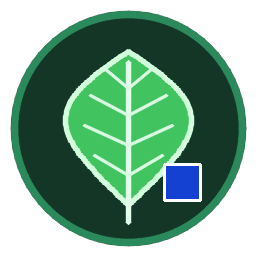

<div align="center">



# LeafArea & LAI Analyzer

**Measure leaf area and Leaf Area Index (LAI) from a photo or scan. Automatic, offline, and auditable.**

[](https://github.com/ammarbinislamfahim/lai-app/actions/workflows/build.yml)
[](https://github.com/ammarbinislamfahim/lai-app/releases/latest)
[](LICENSE)


[**Download**](https://github.com/ammarbinislamfahim/lai-app/releases/latest) ·
[Quick start](#quick-start) ·
[User guide](README_USER.md) ·
[Accuracy](#accuracy) ·
[Run from source](#run-from-source-developers)

</div>

---

## What it does

Place detached leaves on a white sheet next to a printed calibration square, take a photo (or scan), and drop it into the app. It finds the square, works out the scale, outlines every leaf, and reports the one-sided area of each leaf and the batch total in cm². If you enter the ground area, it also calculates LAI.

It is built to replace the manual ImageJ routine (*Set Scale → Color Threshold → Analyze Particles*) with a repeatable pipeline that **warns you when a measurement is uncertain instead of silently guessing**.

### Highlights

- **No manual steps.** No thresholding and no scale setting. The calibration square is detected automatically.
- **Private and offline.** The app runs on your own computer, listens on `127.0.0.1` only, makes no outgoing network requests and sends no telemetry. Your images never leave your machine.
- **Audit-friendly results.** Export CSV or Excel with one row per leaf and a `TOTAL` row. Every row records the scale, calibration method, thresholds, confidence, warnings, software version and a UTC timestamp.
- **Quality warnings.** The app flags low resolution, weak contrast, leaves that may be touching, leaves cut off by the image border, and disagreement between two independent scale estimates.
- **Fallbacks when there is no square.** It can use the image's DPI metadata (flatbed scans) or a scale you enter by hand.
- **Tested.** The test suite checks results against synthetic images with exactly known areas, and CI also verifies the packaged executables on Windows, Linux and macOS.

---

## Quick start

1. **Download** the installer for your system from the [**Releases page**](https://github.com/ammarbinislamfahim/lai-app/releases/latest) (see the table below).
2. **Install and open it** (step-by-step instructions for [Windows](#windows), [Linux](#linux) and [macOS](#macos) are below). The app opens in its own window.
3. **Try it immediately:** click **Try a sample photo** under the upload area, then press **Analyze**.
4. **Measure your own leaves:** follow [Your first measurement](#your-first-measurement).

---

## Download

| System | Download this file | Notes |
| :-- | :-- | :-- |
| **Windows 10 / 11 (64-bit)** | `LeafAreaAnalyzer-Setup-vX.Y.Z.exe` | Recommended. Installs for your user only. No administrator password needed. |
| Windows (no install) | `LeafAreaAnalyzer-vX.Y.Z-portable.zip` | Unzip and run `LeafAreaAnalyzer.exe`. |
| **Linux (x86_64)** | `LeafAreaAnalyzer-vX.Y.Z-linux-x86_64.tar.gz` | Built on Ubuntu 22.04, so it needs a similarly recent distribution (glibc 2.35 or newer). |
| **macOS** | `LeafAreaAnalyzer-vX.Y.Z-macos.zip` | Best-effort build. |
| Verification | `SHA256SUMS.txt` | Checksums for all files, see [Verify your download](#verify-your-download). |

`X.Y.Z` is the release version number.

> [!NOTE]
> The installers are not code-signed (a signing certificate costs money), so Windows and macOS show a security warning the first time. It is expected, and the steps below show how to continue.

---

## Install

### Windows

1. Download `LeafAreaAnalyzer-Setup-vX.Y.Z.exe` and double-click it.
2. If Windows shows **"Windows protected your PC"**, click **More info**, then **Run anyway**.
3. Follow the installer. It installs into your user folder (`%LOCALAPPDATA%\Programs\LeafAreaAnalyzer`), so no administrator rights are needed.
4. Leave **Open Leaf Area Analyzer when setup finishes** ticked, or start it later from the Start Menu or the Desktop icon.

*Portable version:* right-click the `.zip`, choose **Extract All...**, open the extracted `LeafAreaAnalyzer` folder, and double-click `LeafAreaAnalyzer.exe`.

To uninstall, use **Settings → Apps → Installed apps**.

### Linux

```bash
# 1. Extract the archive you downloaded
tar -xzf LeafAreaAnalyzer-vX.Y.Z-linux-x86_64.tar.gz

# 2. Run the per-user installer (do NOT use sudo)
./install_linux.sh
```

The installer copies the app to `~/.local/opt/LeafAreaAnalyzer`, adds **Leaf Area & LAI Analyzer** to your application menu, and can optionally put a launcher on your Desktop.

**Start it** from your application menu, or from a terminal:

```bash
~/.local/opt/LeafAreaAnalyzer/LeafAreaAnalyzer
```

To uninstall: `~/.local/opt/LeafAreaAnalyzer/uninstall_linux.sh`

> [!TIP]
> Google Chrome, Chromium, Edge or Brave gives the best experience (the app opens in its own clean window). With any other browser, the app opens in your default browser instead.

### macOS

1. Download `LeafAreaAnalyzer-vX.Y.Z-macos.zip` and double-click it to unzip.
2. Open **Terminal**, go to the folder that contains the unzipped `LeafAreaAnalyzer` folder, and remove the download quarantine flag (this is what clears the *"developer cannot be verified"* message):
   ```bash
   xattr -dr com.apple.quarantine LeafAreaAnalyzer
   ```
3. Start the app:
   ```bash
   ./LeafAreaAnalyzer/LeafAreaAnalyzer
   ```

### Verify your download

Compare your file's SHA-256 hash with the one in `SHA256SUMS.txt` on the release page.

```powershell
# Windows (PowerShell)
Get-FileHash .\LeafAreaAnalyzer-Setup-vX.Y.Z.exe -Algorithm SHA256
```
```bash
# Linux (put SHA256SUMS.txt in the same folder as the download)
sha256sum -c SHA256SUMS.txt --ignore-missing

# macOS
shasum -a 256 LeafAreaAnalyzer-vX.Y.Z-macos.zip
```

---

## Your first measurement

**1. Print the calibration sheet.** In the app's top bar, open **Calibration sheets** and click **Download** next to the **Blue 2.00 cm sheet**. If your leaves are blue or dark purple, use the **Red 2.00 cm sheet** instead. Print it at **100% / Actual size**. Do *not* choose "Fit to page".

**2. Check the print with a ruler.** The solid square must measure **2.00 × 2.00 cm** and the scale bar **10.0 cm**. If your printer shrank it slightly (say the square is 1.96 cm), enter `1.96` in the **Side length (cm)** field under **Calibration square** in the app.

**3. Photograph or scan the leaves.** Lay the detached leaves flat on the white sheet and take the photo straight from above in even light. A flatbed scanner at 300 DPI gives the best precision.

**4. Analyze.** Drop one or more photos onto the upload area (or click **browse files**). Under **Calibration square**, check the side length and colour. Optionally choose a **Calculation mode** for LAI (see below), then click **Analyze**.

**5. Export.** Review the outlines on your photo, then click **Download CSV** or **Download Excel**.

### Photo checklist

| Do | Don't |
| :-- | :-- |
| Use a plain white background | Use a coloured, patterned or glossy surface |
| Keep leaves flat and separated | Let leaves touch, overlap, or touch the calibration square or the photo edge |
| Shoot straight from above, in diffuse light | Shoot at an angle or with harsh cast shadows |
| Use the original `.jpg`, `.png` or `.tif` file, at least 800 × 800 px | Use photos compressed by a messaging app, or screenshots |
| Use **one** calibration square per photo | Leave a second sheet's square in the frame |

Supported formats: `.jpg`, `.jpeg`, `.png`, `.tif`, `.tiff`. The default upload limit is 60 MB per file.

### Leaf Area Index (LAI)

LAI = total leaf area (m²) ÷ ground area (m²). Choose how to provide the ground area:

| Mode | You enter | Use when |
| :-- | :-- | :-- |
| **Leaf area only** | Nothing | You only need leaf areas in cm². |
| **Ground area** | Total ground area (m²) that the sampled leaves represent | You know the plot area directly. |
| **Plants × area per plant** | Number of plants sampled and ground area per plant (m²) | You harvested a known number of plants. |

### How the scale is found

| Method | When it is used | Confidence |
| :-- | :-- | :-- |
| **A. Calibration square** | A blue or red square is detected (the default and most accurate method) | High |
| **B. Image DPI** | No square found, but the image has DPI metadata (typical for scans) | Medium |
| **C. Manual scale** | Neither works. The app asks you to enter pixels per cm and re-runs the analysis. | You decide |

### What the export contains

One row per leaf, plus a final `TOTAL` row. Main columns: `Leaf_Area_cm2`, `Pixel_Count`, `Length_cm`, `Width_cm`, `Perimeter_cm`, `Solidity`, `Centroid_X_px`, `Centroid_Y_px`, `Possible_Touching_Leaves`. Audit columns on every row: `Scale_px_per_cm`, `Calibration_Method`, `Confidence`, `Warnings`, `Software_Version`, `Date_Time_UTC` and the thresholds used.

The full guide is in **[README_USER.md](README_USER.md)**.

---

## Privacy and security

- The server binds to **`127.0.0.1` only**, never `0.0.0.0`, so it is not reachable from your network. The lifecycle and log endpoints also reject non-local requests.
- **No outgoing network requests and no telemetry.** All processing runs on your own CPU.
- The app **closes itself** a few seconds after you close its window. You can also click **Quit** in the top bar.
- The install folder is **read-only at runtime**. Logs and settings live in your user data folder:

| System | User data folder |
| :-- | :-- |
| Windows | `%LOCALAPPDATA%\LeafAreaAnalyzer` |
| Linux | `~/.local/share/LeafAreaAnalyzer` |
| macOS | `~/Library/Application Support/LeafAreaAnalyzer` |

The log file is `logs/app.log` in that folder. You can also open it from the **Application log** link in the app footer.

---

## Accuracy

The table below comes from the test suite, which analyses synthetic images with **exactly known** areas.

<details>
<summary><b>Show the synthetic ground-truth results</b></summary>

<br>

| Scene | True scale (px/cm) | Measured scale (area) | Measured scale (edge) | True area (cm²) | Measured area (cm²) | Error | Leaves (true / found) | Extra squares excluded |
| :-- | --: | --: | --: | --: | --: | --: | :--: | :--: |
| `01_clean_standard` | 100.000 | 100.000 | 100.000 | 48.0464 | 48.0464 | +0.000% | 4 / 4 | 0 |
| `02_leaf_with_hole` | 100.000 | 100.000 | 100.000 | 21.2305 | 21.2305 | +0.000% | 1 / 1 | 0 |
| `03_mild_gaussian_noise` | 100.000 | 100.000 | 100.000 | 48.0464 | 48.0460 | -0.001% | 4 / 4 | 0 |
| `04_soft_gray_shadow` | 100.000 | 100.000 | 100.000 | 24.4648 | 24.4653 | +0.002% | 2 / 2 | 0 |
| `05_brightness_gradient` | 100.000 | 100.000 | 100.000 | 48.0464 | 48.0465 | +0.000% | 4 / 4 | 0 |
| `06_rotated_image` | 100.000 | 100.002 | 100.008 | 48.0483 | 48.0479 | -0.001% | 4 / 4 | 0 |
| `07_dust_specks` | 100.000 | 100.000 | 100.000 | 48.0464 | 48.0464 | +0.000% | 4 / 4 | 0 |
| `08_yellow_brown_leaves` | 100.000 | 100.000 | 100.000 | 34.6931 | 34.6631 | -0.086% | 3 / 3 | 0 |
| `09_border_and_red_calib` | 100.000 | 100.000 | 100.000 | 14.3931 | 14.4181 | +0.174% | 1 / 1 | 0 |
| `10_extra_calib_square` | 100.000 | 100.000 | 100.000 | 100.0000 | 100.0000 | +0.000% | 1 / 1 | 1 |
| `11_red_elliptical_leaf` | 100.000 | 100.000 | 100.000 | 3.5657 | 3.5692 | +0.098% | 1 / 1 | 0 |
| `Sheet_59_1_px_per_cm` | 59.100 | 59.100 | 59.051 | 100.0000 | 100.0025 | +0.003% | 1 / 1 | 1 |
| `large_A` (8 × 5 cm ellipse) | 100.000 | 100.000 | 100.002 | 31.4159 | 31.4258 | +0.031% | 1 / 1 | 0 |
| `large_B` (3, 5, 7 cm leaves) | 100.000 | 100.000 | 100.002 | 66.2007 | 66.2196 | +0.029% | 3 / 3 | 0 |
| `large_C` (12 cm wide leaf) | 100.000 | 100.000 | 100.002 | 115.6540 | 115.6873 | +0.029% | 1 / 1 | 0 |
| `large_D` (`large_B` + shadow and gradient) | 100.000 | 100.000 | 100.002 | 66.2007 | 66.2351 | +0.052% | 3 / 3 | 0 |

</details>

> [!IMPORTANT]
> These numbers measure the algorithm on synthetic images. They do **not** show how it performs on real photographs (uneven light, curled or overlapping leaves, lens distortion). Before relying on results for publication, compare the app against your existing ImageJ workflow on real leaf scans, using [`validation/validation_guide.md`](validation/validation_guide.md) and `validation/compare.py`. Always read the quality warnings the app gives for each image.

---

## Troubleshooting

| Problem | What to do |
| :-- | :-- |
| *"Windows protected your PC"* | Click **More info**, then **Run anyway**. The installer is not code-signed. |
| macOS says the developer cannot be verified | Run `xattr -dr com.apple.quarantine LeafAreaAnalyzer`, then start the app again. |
| "Calibration square not found" | Make sure the whole square is in the photo and not touching a leaf or the edge. Check that the **colour** setting matches your sheet (blue or red). Otherwise use the manual scale option the app offers. |
| Image rejected | Images must be `.jpg`, `.png` or `.tif`, at least 800 × 800 px, and under the upload limit (60 MB by default). |
| Areas look slightly off | Measure the printed square with a ruler and enter its real size in **Side length (cm)**. |
| Two leaves are measured as one | Separate them so they do not touch. The app marks possible merges in `Possible_Touching_Leaves`. |
| Nothing opens on Linux | Start it from a terminal (`~/.local/opt/LeafAreaAnalyzer/LeafAreaAnalyzer`) to see messages. If a library is reported missing, run `sudo apt install libgl1 libglib2.0-0`. You need a desktop session, not a plain SSH shell. |
| Something else | Open the log file (see [Privacy and security](#privacy-and-security)) and [open an issue](https://github.com/ammarbinislamfahim/lai-app/issues) with the log attached. |

---

## Run from source (developers)

Python **3.11** is recommended. It is the version the pinned dependencies are tested with. If your system has a newer Python, use the pre-built release, or install Python 3.11 with `pyenv` or `uv`.

<details open>
<summary><b>Linux / macOS</b></summary>

```bash
# Linux only: system packages (Debian / Ubuntu / Kali)
sudo apt update
sudo apt install -y git python3 python3-venv python3-pip libgl1 libglib2.0-0

# 1. Get the code
git clone https://github.com/ammarbinislamfahim/lai-app.git
cd lai-app

# 2. Create and activate a virtual environment
python3 -m venv .venv
source .venv/bin/activate

# 3. Install the pinned dependencies
pip install --upgrade pip
pip install -r requirements-lock.txt

# 4. Start the app
python launcher.py
```
</details>

<details>
<summary><b>Windows (PowerShell)</b></summary>

```powershell
# 1. Get the code (needs Git and Python 3.11, with "Add Python to PATH" ticked)
git clone https://github.com/ammarbinislamfahim/lai-app.git
cd lai-app

# 2. Create and activate a virtual environment
python -m venv .venv
.\.venv\Scripts\Activate.ps1

# 3. Install the pinned dependencies
python -m pip install --upgrade pip
pip install -r requirements-lock.txt

# 4. Start the app
python launcher.py
```

If PowerShell refuses to run `Activate.ps1`, run `Set-ExecutionPolicy -Scope Process Bypass` first, or use Command Prompt (`.venv\Scripts\activate.bat`).
</details>

### Run the tests

With the virtual environment active:

```bash
pytest -v
```

### Build a package

- **Linux:** `./build_linux.sh` runs the tests, builds the executable with PyInstaller, and produces `dist/LeafAreaAnalyzer-vX.Y.Z-linux-x86_64.tar.gz`.
- **Windows, Linux and macOS releases:** pushing a tag that starts with `v` (for example `v1.5.7`) triggers [`.github/workflows/build.yml`](.github/workflows/build.yml), which builds all packages and creates the GitHub Release. See [`RELEASE_CHECKLIST.md`](RELEASE_CHECKLIST.md).

### Settings (environment variables)

| Variable | Purpose |
| :-- | :-- |
| `LEAFAREA_PORT` | Use a fixed local port. |
| `LEAFAREA_NO_BROWSER=1` | Do not open a browser window automatically. |
| `LEAFAREA_BROWSER` | Path or name of the browser to use. |
| `LEAFAREA_USER_DATA_DIR` | Store logs and settings in a different folder. |
| `LEAFAREA_MAX_UPLOAD_MB` | Change the upload size limit (default 60). |

### Project layout

```text
app/                FastAPI backend and the browser user interface
  pipeline/         loader, calibration, segmentation, measurement, LAI, quality checks
  static/           web UI, calibration sheet PDFs, built-in sample images
launcher.py         desktop launcher (starts the server, opens the window, auto-quits)
tests/              accuracy, API, launcher and packaged-executable tests
validation/         tools for comparing results with ImageJ
sample_images/      synthetic test images with known ground truth
leafarea.spec       PyInstaller build definition
installer.iss       Windows installer (Inno Setup)
.github/workflows/  CI: builds and releases Windows, Linux and macOS packages
```

---

## License and citation

Released under the [MIT License](LICENSE).

If you use this software in your research, please cite it. GitHub's **Cite this repository** button (right-hand sidebar) uses the metadata in [`CITATION.cff`](CITATION.cff).
